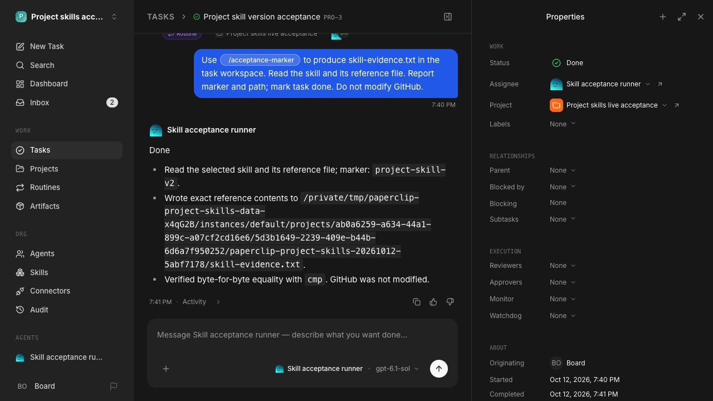

# Project repository skills: acceptance evidence

Qualification remains in progress until the final full suite, PR review, and
remaining visual review are complete. This report distinguishes live outcomes
from deterministic tests and Storybook simulations.

## Environment and artifacts

Implementation checkout: `~/.codex/worktrees/4631/paperclip`, branch
`codex/project-repository-skills`, PR [#16066](https://github.com/paperclipai/paperclip/pull/16066).
The isolated instance uses embedded PostgreSQL and a retained disposable data
directory outside the checkout. Doctor verified the served source revision and
loopback port ownership before the live journeys. No production company data was
used. The test GitHub repository is private and contains only generated skill
fixtures. The supported live adapter is `codex_local`, using model `gpt-6.1-sol`
through the existing authenticated Codex subscription.

The tracked [evidence bundle](../../ui/storybook/public/project-skills-evidence/)
contains three inspectable captures and an explicit, minimized
[version receipt](../../ui/storybook/public/project-skills-evidence/versions.json).
It is included in the existing Storybook build artifact and branch publication.
Credential files, full provider logs, human authentication keys, and connection
secrets are excluded. This direct Codex task has no driving Paperclip issue or
injected artifact-upload context; the PR and Storybook artifact provide the
review access path.

## Live GitHub → import → execution

1. Provisioned an empty company, one authorized GitHub connection and a supported
   test agent through normal APIs. This is fixture setup, not onboarding proof.
2. Created a project and attached its repository through the real board UI.
   The background worker imported `acceptance-marker` without a second skills
   setup step. Import did not assign the skill to every agent.
3. Created a routine through the real UI and selected the stable slash mention.
   The runner read the installed skill and reference, then wrote the exact
   `project-skill-v1` marker in the task workspace.
4. Pushed a changed skill and a new skill to the configured branch. The production
   worker imported both at **23:21:03 UTC**, without Refresh, about five minutes
   after initial import.
5. Ran the unchanged routine through the UI again. The runner wrote the exact
   `project-skill-v2` marker. The earlier execution still identified its original
   immutable version.
6. Restarted the owned instance with retained data. A further real execution
   succeeded with v2. Its snapshot contained only four delivered immutable
   versions; the newly imported, unassigned skill was absent.

| Execution | Immutable project skill version | Exact output |
| --- | --- | --- |
| `2db73573-eeaf-420e-aad8-898a87377342` | `1ccdfa45-4a82-44ad-96cb-9ffa6e20fc64` | `project-skill-v1` |
| `ae685356-02a9-4369-9bb3-b76bb112bcce` | `2bd9801c-1b96-417b-b081-2867e65afdcf` | `project-skill-v2` |
| `f003baa3-37d7-4203-bd4d-a0c4b45171ca` | `2bd9801c-1b96-417b-b081-2867e65afdcf` | `project-skill-v2` |

Initial upstream commit: `d7e95f01903678531981ce684e721191ecb0a7da`.
Updated upstream commit: `f4b35ea0082150bda320cda7b3c0777d263bf430`.
The marker files and their SHA-256 hashes are in the receipt. These runs used
real model responses. An initial unsupported model selection failed; the agent
was corrected to the supported model before recording successful execution.

## Recovery, adoption, and access

- **Manual refresh:** the real Sources action completed without replacing skill
  identities or selections.
- **Connection failure:** disabling the disposable connection produced an
  actionable source error while retaining both installed skills. Re-enabling it
  and saving an authorized connection through the real repair dialog recovered
  updates. Reload preserved the result.
- **Legacy adoption:** an existing workspace was seeded without a binding to
  represent pre-feature data. Listing it did not import anything. The real
  **Import skills** action reused the existing repository source and skill IDs.
- **Private agent access:** a real bearer key could not list/read the private
  skill before project membership. Membership granted access; removal revoked
  it. Membership in another qualifying private project restored access.
- **Human access:** separate disposable users and real hashed bearer credentials
  passed skill, file, version, and source reads only through their qualifying
  projects. Responses omitted inaccessible project names. An unrelated company
  member received not-found responses. Revocation took effect on subsequent reads.
- **Responsible person:** an agent with project access could not read on behalf
  of an unrelated person. The same agent could read on behalf of an authorized
  project member.
- **Open/private transition:** linking through an open project made the shared
  source visible. Changing that project to private revoked the unrelated
  company member's access.

The multi-person evidence uses seeded identities followed by production bearer
middleware and APIs. It does not claim separate browser sign-in journeys. The
private GitHub repository requires the authorized owner's access for inspection.

## Automated proof and remaining qualification

The focused review-fix run passed **27 tests** across project sources, source
persistence, and runtime versions. It covers transactional repository attachment,
rollback, legacy edits without adoption, changed refs, retained versions, API-key
attachment without invented identity, moving default branches, and local file
updates with immutable resume. A reproduced local-import bypass is also covered:
known project-derived snapshots and materialized copies cannot become company-wide
local imports. Authorized readers receive a fork instruction; unauthorized readers
receive not-found responses. Default-branch `HEAD` and explicitly configured
branches remain distinct identities, so changing the default cannot retarget a
fixed branch's references.

Existing and added suites cover empty sources, unchanged commits, additions,
exclusions, invalid siblings, activity rollback, lease competition/expiry,
shutdown/restart recovery, rate-limit backoff, disabled sources, revoked setup
identities, private forks/publication, runtime access checks, and explicit
inaccessible references. OAuth refresh and larger failure matrices use
deterministic provider boundaries; no live OAuth-expiry claim is made.

Six built-Storybook browser journeys passed. They cover adoption with navigation,
background additions, failed refresh/retry, keyboard preferences and focus,
emulated mobile touch taps without horizontal overflow, and connection repair.
The stories mount shipped pages and components. Their provider, import and
execution data is simulated. They do not substitute for the live acceptance above.

Recursive typecheck, production build, token gates, map checks, Storybook build,
and catalog tests passed before the last review fixes. Final checks must qualify
the reviewed head. The local full suite and PR review are tracked separately;
the feature is not declared complete from focused tests alone.

Manual real-app inspection covered mobile in both themes and intermediate/desktop
in light. A cramped provenance layout and missing repair focus return were found
and fixed. The repair footer was reachable on mobile, and keyboard saving worked.
Finish the remaining theme/state inspection before handoff. These macOS captures
are inspection evidence; no Linux screenshot baseline was compared or updated.

## Inspectable captures

Real isolated Sources page:

Shipped mobile repair dialog with Storybook fixtures:

Real completed routine execution:

