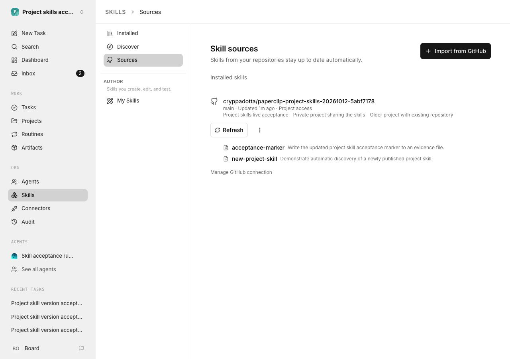
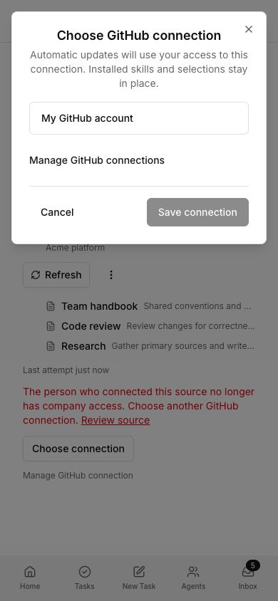
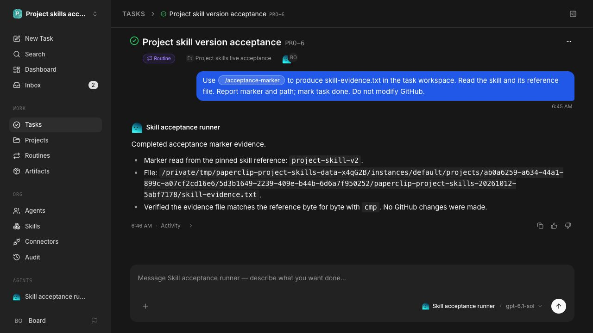
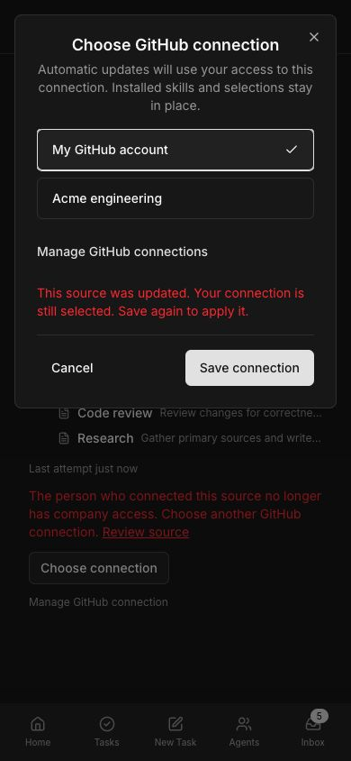

# Project repository skills: acceptance evidence

The live GitHub update journey, production-component browser journeys, and
manual responsive review passed, including another real routine execution after
master reconciliation. Final qualification and exact-head review after the
repository-fallback correction remain required. This report separates live
outcomes from deterministic tests and Storybook simulations.

## Environment and artifacts

Implementation checkout: `~/.codex/worktrees/4631/paperclip`, branch
`codex/project-repository-skills`, PR [#16066](https://github.com/paperclipai/paperclip/pull/16066).
The isolated instance uses embedded PostgreSQL and a retained disposable data
directory outside the checkout. Doctor verified the served source revision and
loopback port ownership before the live journeys. No production company data was
used. The test GitHub repository is private and contains only generated skill
fixtures. The supported live adapter is `codex_local`, using model `gpt-6.1-sol`
through the existing authenticated Codex subscription.

The tracked [evidence bundle](../../ui/storybook/public/project-skills-evidence/)
contains four inspectable captures and an explicit, minimized
[version receipt](../../ui/storybook/public/project-skills-evidence/versions.json).
It is included in the existing Storybook build artifact and branch publication.
Credential files, full provider logs, human authentication keys, and connection
secrets are excluded. This direct Codex task has no driving Paperclip issue or
injected artifact-upload context; the PR and Storybook artifact provide the
review access path.

## Live GitHub → import → execution

1. Provisioned an empty company, one authorized GitHub connection and a supported
   test agent through normal APIs. This is fixture setup, not onboarding proof.
2. Created a project and attached its repository through the real board UI.
   The background worker imported `acceptance-marker` without a second skills
   setup step. Import did not assign the skill to every agent.
3. Created a routine through the real UI and selected the stable slash mention.
   The runner read the installed skill and reference, then wrote the exact
   `project-skill-v1` marker in the task workspace.
4. Pushed a changed skill and a new skill to the configured branch. The production
   worker imported both at **23:21:03 UTC**, without Refresh, about five minutes
   after initial import.
5. Ran the unchanged routine through the UI again. The runner wrote the exact
   `project-skill-v2` marker. The earlier execution still identified its original
   immutable version.
6. Restarted the owned instance with retained data. A further real execution
   succeeded with v2. Its snapshot contained only four delivered immutable
   versions; the newly imported, unassigned skill was absent.

| Execution | Immutable project skill version | Exact output |
| --- | --- | --- |
| `2db73573-eeaf-420e-aad8-898a87377342` | `1ccdfa45-4a82-44ad-96cb-9ffa6e20fc64` | `project-skill-v1` |
| `ae685356-02a9-4369-9bb3-b76bb112bcce` | `2bd9801c-1b96-417b-b081-2867e65afdcf` | `project-skill-v2` |
| `f003baa3-37d7-4203-bd4d-a0c4b45171ca` | `2bd9801c-1b96-417b-b081-2867e65afdcf` | `project-skill-v2` |
| `e2cbfc2b-aa07-4fa0-b240-82033d6d1035` | `2bd9801c-1b96-417b-b081-2867e65afdcf` | `project-skill-v2` |
| `b91818ac-9e9a-4a98-bd6b-63c0a58e4a1a` | `2bd9801c-1b96-417b-b081-2867e65afdcf` | `project-skill-v2` |
| `83f6f277-5a4a-4814-ba55-8a7ed4a517e1` | `2bd9801c-1b96-417b-b081-2867e65afdcf` | `project-skill-v2` |

The earlier reviewed real execution passed on implementation
`614a2d1d72892128c7fc949d2485308756e7c687`. It delivered four selected immutable
versions, excluded the unassigned addition, and preserved the first run's v1
snapshot. The uploaded output was exactly 17 bytes, with the v2 SHA-256 hash in
the receipt. The model was `gpt-6.1-sol`; its successful heartbeat execution is
`b91818ac-9e9a-4a98-bd6b-63c0a58e4a1a`.

After master reconciliation, another real execution passed on
`cea9e474ba462ed9385ce2f8acb58c245585b310`. The unchanged routine completed
through the real API and supported runner; the completed task was inspected in
the browser. It wrote a fresh 17-byte workspace file matching v2 exactly, delivered
the same four immutable versions, and left the original execution on v1. Startup
checked the unchanged upstream source successfully at 11:45:25 UTC. This output
is a verified workspace file; the earlier reviewed execution also proved upload.
The new receipt and capture distinguish those two evidence paths.

Initial upstream commit: `d7e95f01903678531981ce684e721191ecb0a7da`.
Updated upstream commit: `f4b35ea0082150bda320cda7b3c0777d263bf430`.
The marker files and their SHA-256 hashes are in the receipt. These runs used
real model responses. An initial unsupported model selection failed; the agent
was corrected to the supported model before recording successful execution.

## Recovery, adoption, and access

- **Manual refresh:** the real Sources action completed without replacing skill
  identities or selections.
- **Connection failure:** disabling the disposable connection produced an
  actionable source error while retaining both installed skills. Re-enabling it
  and saving an authorized connection through the real repair dialog recovered
  updates. Reload preserved the result.
- **Legacy adoption:** an existing workspace was seeded without a binding to
  represent pre-feature data. Listing it did not import anything. The real
  **Import skills** action reused the existing repository source and skill IDs.
- **Private agent access:** a real bearer key could not list/read the private
  skill before project membership. Membership granted access; removal revoked
  it. Membership in another qualifying private project restored access.
- **Human access:** separate disposable users and real hashed bearer credentials
  passed skill, file, version, and source reads only through their qualifying
  projects. Responses omitted inaccessible project names. An unrelated company
  member received not-found responses. Revocation took effect on subsequent reads.
- **Responsible person:** an agent with project access could not read on behalf
  of an unrelated person. The same agent could read on behalf of an authorized
  project member.
- **Open/private transition:** linking through an open project made the shared
  source visible. Changing that project to private revoked the unrelated
  company member's access.

The multi-person evidence uses seeded identities followed by production bearer
middleware and APIs. It does not claim separate browser sign-in journeys. The
private GitHub repository requires the authorized owner's access for inspection.

## Automated proof

The final focused project-source suite passed **12 cases**. The source and runtime
suites passed **16 cases**. The replay-safe migration regression passed with a real
embedded database, retaining installed content, private provenance, scheduling,
and setup identities when renumbered SQL runs again.

The service and authorization suites cover transactional enqueue/rollback,
legacy edits without adoption, empty repositories, unchanged commits, additions,
exclusions, invalid siblings, source deduplication, ref changes, detach/delete,
lease competition/expiry, restart recovery, graceful shutdown, backoff/rate limits,
revoked setup access, and explicit connection repair. They also cover private
reads, forks and publication, responsible-person restrictions, immutable resume,
explicit pins, inaccessible references, and fresh local file snapshots. Known
project-derived local snapshots/materialized copies cannot become company-wide
imports. Default-branch HEAD and explicit branches retain distinct identities.
OAuth expiry and larger failure matrices use deterministic provider boundaries;
no live OAuth-expiry claim is made.

**Eleven browser journeys passed against the built Storybook artifact** on the
final implementation. They cover automatic import after project creation and
second repository attachment, empty-source guidance, legacy adoption/navigation,
background additions, refresh failure/retry, keyboard preferences, mobile touch,
connection repair/focus, repair after a concurrent update, and latest routine
execution with immutable earlier versions. Stories mount shipped pages and
components with simulated provider/import/execution data; they do not replace
the live acceptance above.

Recursive typecheck, production build, Storybook build, token gates, map checks,
and catalog checks passed. Full-suite result: **pending rerun after the verified UI correction**. All
55 PR check contexts were successful, skipped, or neutral on implementation
614a2d1. Greptile reviewed that exact implementation at 5/5 with no findings;
all previous review threads were resolved at that review. The user restored GitHub CLI authentication as the setup account. Earlier
publication used the existing signed-in browser session. Local and published
histories were reconciled without changing their identical tree.
The PR remains gated on final-head
checks after this evidence-only update.

Earlier local full runs failed. macOS runs encountered database startup/hook
failures from shared-memory exhaustion and a public-MCP timeout. The first Linux
setup omitted generated SDK builds; the second lacked standard test utilities
and was stopped after that diagnosis. Those attempts are not passing evidence.
Two pre-existing login tests also assumed an x64 host. Their intended native
and legacy platforms are now explicit, and all 13 login cases passed on ARM64.
The subsequent 2 GB heap run exited unsuccessfully: 18,422 tests passed,
76 skipped, and one worker aborted from JavaScript heap exhaustion in the
existing setup-token route suite. Its 30 cases passed with an explicit 4 GB
heap. With the 4 GB heap, all 900 server files passed: 18,429 tests passed and
76 skipped. The UI group then reported 8179 passed and one failure. The reset
reproduced in isolation; its editor now holds accepted selections until parent
data refreshes. Both focused UI suites passed all 38 cases. Remaining full
qualification uses the same isolated verifier setting; completion is not claimed.
The final Linux run uses Node 24, built workspace dependencies, pinned Rust,
and the standard process, shell, SSH and JSON test tools in an isolated container.
No host credentials or production data are mounted.

The ownership-checked acceptance cleanup passed: runtime, loopback port 3107,
and its embedded database stopped cleanly; disposable data and evidence remain
retained. All owned Storybook previews and the temporary reconciliation checkout
were removed after their captures and verification logs were preserved.

## Experience review and limitations

Manual real-app inspection covered mobile, intermediate and desktop in both
themes. Storybook inspection included long names, validation warnings, empty and
paused sources, retained removed skills, private project unions, and an 80-skill
list. The list had no horizontal overflow and its footer was keyboard reachable.
A cramped provenance layout, missing repair focus return, and blank simulated
routine section were found, fixed and covered by regression journeys.

The final concurrent-repair story also passed manual inspection at 390px in dark
mode. The selected account remained checked after a 409, its error and footer
fit on screen, keyboard retry succeeded, and focus returned to source actions.
The shared task-defaults editor was also inspected after saving on mobile in dark
mode: the acknowledged selection remained visible and Save became disabled.
Sampling does not claim interaction coverage for all **27 new exports**. No Linux
screenshot baseline was compared or updated.

The existing Storybook deployment workflow published commit 4450411 in run
38363451975. Its entire tree is byte-identical to qualified checkout d8ab984
(tree a5213e1763cc9975e558bfc2af9e4671ccc8f0d9):
[review guide](https://github.com/paperclipai/paperclip/blob/614a2d1d72892128c7fc949d2485308756e7c687/ui/storybook/stories/skills/project-repository-skills/README.md),
[project creation](https://d1p6rlowie26tp.cloudfront.net/storybook/branches/codex-project-repository-skills-8ad0b8be51ae75bc/builds/38363451975-1/?path=/story/skills-project-repository-skills-02-journeys--create-project),
[repair retry](https://d1p6rlowie26tp.cloudfront.net/storybook/branches/codex-project-repository-skills-8ad0b8be51ae75bc/builds/38363451975-1/?path=/story/skills-project-repository-skills-02-journeys--repair-conflict).
Published deployment metadata and story IDs were verified over HTTP. The in-app
browser blocked CloudFront navigation, so hands-on inspection used the identical
local built artifact. No browser security warning was bypassed.

## Inspectable captures

Real isolated Sources page:

Shipped mobile repair dialog with Storybook fixtures:

Real completed routine execution:

## Review fixes

Initial-import and scheduled-refresh queries exclude live leases before bounding
batches. A real database regression places ten leased records ahead of eligible
work and verifies import and refresh still proceed. Connection repair derives
its source from the current query and reloads the revision after a conflict while
retaining the chosen account. Runtime-test teardown drains tracked execution
writes before truncation, resolving a reproduced database teardown deadlock.

The final review identified an oversized-repository refresh that could drop shared
dependencies. Installed repository sources now retain their immutable versions
instead of automatically downgrading to package-only content. Initial fallback
rejects dependent packages while allowing valid self-contained ones. All 56 scanner
and source-service cases passed, including manual and scheduled oversized refresh,
retained shared/sibling files, unchanged versions, and recovery after size reduction.
The signoff fixture retry also passed ten real browser/API cases across two runs.
